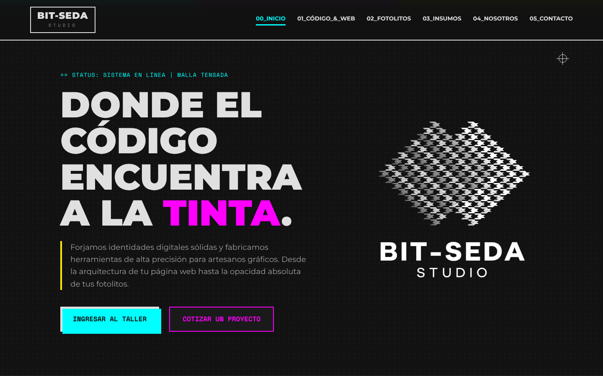
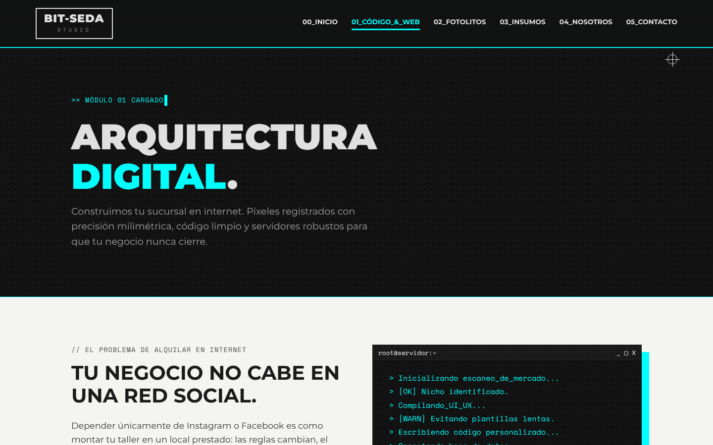
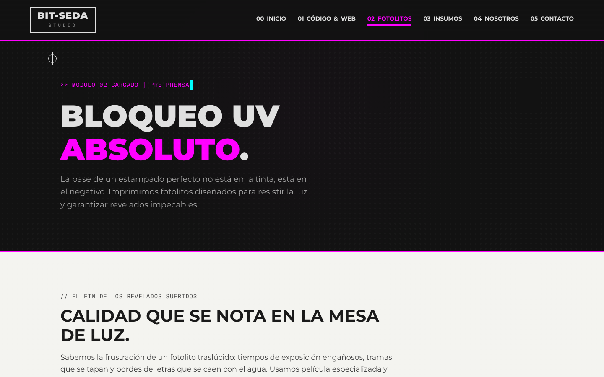
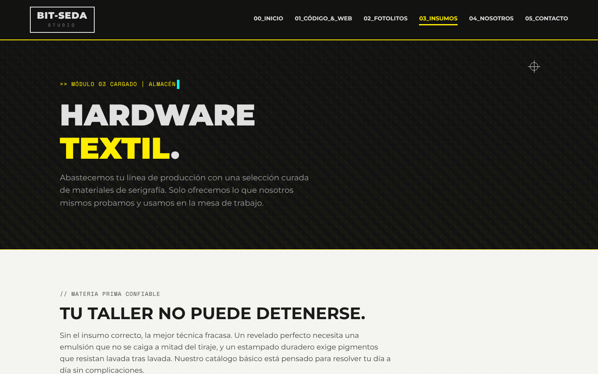
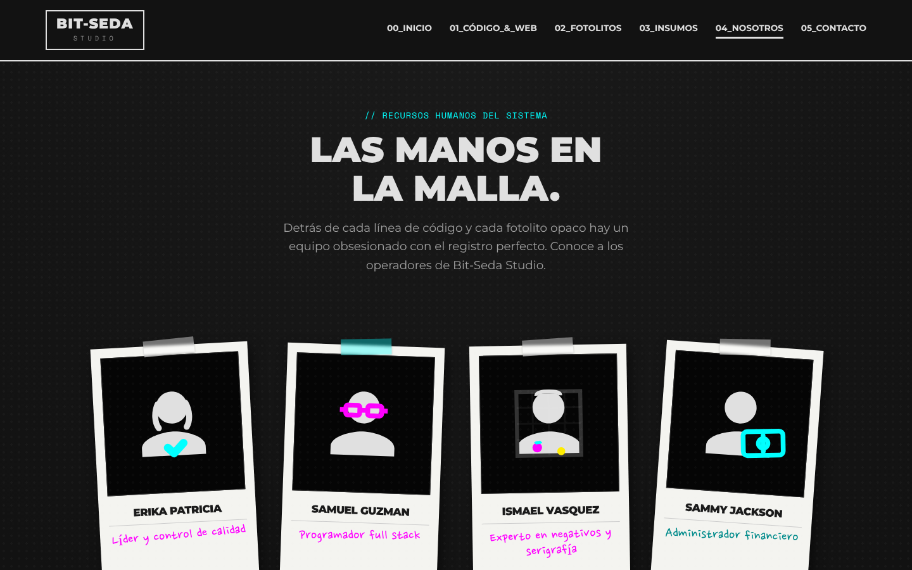
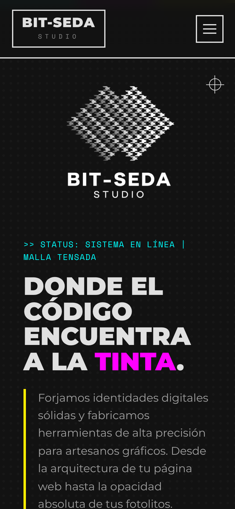

# Bit-Seda Studio

Sitio web de Bit-Seda Studio, un estudio ubicado en Villa Nueva, Guatemala, que combina **desarrollo web para negocios locales** y **serigrafía** (fotolitos e insumos). El proyecto está construido con **HTML, CSS y JavaScript vanilla**, sin frameworks ni paso de compilación.

> **Demo:** [Bit-Seda Studio](https://silversays.github.io/bitseda-studio/)



## Sobre el proyecto

Bit-Seda Studio combina programación y serigrafía en una misma experiencia digital. El sitio presenta servicios de desarrollo web a medida para pequeños negocios, además de fotolitos de alta densidad e insumos para serigrafía.

## Qué demuestra este proyecto

- **Dirección visual propia:** estética "CMYK sobre modo oscuro" con metáforas de impresión (marcas de registro, tramas de semitono, efecto fuera de registro).
- **Animaciones solo con CSS:** código que se teclea y se renderiza en vivo, separación de capas CMYK con `mix-blend-mode`, rasero de serigrafía con `clip-path`, línea de tiempo con pulso de datos.
- **Arquitectura CSS mantenible:** tokens en variables CSS, una hoja base y una hoja por página, y tema de color por página con `data-theme` (un solo cambio recolorea header, navegación y acentos).
- **Accesibilidad:** enlace para saltar al contenido, menú móvil con `aria-expanded` y cierre con `Esc`, `aria-current` en la navegación, foco visible, etiquetas asociadas en el formulario, animaciones decorativas ocultas a lectores de pantalla y soporte de `prefers-reduced-motion`.
- **Formulario con validación nativa + mensajes propios**, honeypot anti-spam, preselección del servicio por URL (`contacto.html?servicio=web`) y envío opcional a un endpoint externo.
- **Responsive real** (probado de 390 px a 1440 px, sin desbordes horizontales).
- **Rendimiento:** fuentes autoalojadas en `woff2`, imagen del logo optimizada (WebP, 97 KB), cero dependencias en tiempo de ejecución.
- **SEO y compartición:** `title` y `description` por página, Open Graph / Twitter Card, favicon SVG y página 404.
- **Calidad automatizada:** validación HTML con `html-validate` en GitHub Actions y despliegue automático a GitHub Pages.

## Páginas

| Página | Contenido |
|---|---|
| `index.html` | Portada, filosofía y servicios |
| `web.html` | Módulo de desarrollo web, simulación código→navegador y proceso de trabajo |
| `fotolitos.html` | Módulo de pre-prensa, simulación de separación CMYK y especificaciones de archivo |
| `insumos.html` | Catálogo de insumos y simulación de estampado con rasero |
| `nosotros.html` | Equipo en formato polaroid con avatares SVG |
| `contacto.html` | Formulario y datos de contacto |

<p>
  
  
</p>
<p>
  
  
</p>
<p>
  
</p>

## Estructura

```
.
├── index.html · web.html · fotolitos.html · insumos.html · nosotros.html · contacto.html · 404.html
├── css/
│   ├── fonts.css          # @font-face (fuentes autoalojadas)
│   ├── base.css           # tokens, reset, header/footer, botones, utilidades
│   └── pages/             # estilos específicos de cada página
├── js/main.js             # menú móvil, reveal on scroll, formulario
├── assets/
│   ├── fonts/             # Montserrat, Space Mono, Nanum Pen Script (OFL)
│   └── img/               # logo, favicon, imagen Open Graph
├── docs/screenshots/      # capturas para este README
└── .github/workflows/     # validación + despliegue a GitHub Pages
```

## Ejecutar en local

No necesita instalación. Cualquier servidor estático sirve:

```bash
python3 -m http.server 8000     # y abre http://localhost:8000
# o
npm start                       # usa "serve"
```

Validar el HTML:

```bash
npm install
npm run lint:html
```

## Personalización

- **Colores:** las variables globales están al inicio de `css/base.css`. El acento de cada página se define con `data-theme` en el `<body>`.
- **Datos de contacto:** el teléfono (`+502 0000 0000`) y el correo (`hola@bitseda.example`) de `contacto.html` son datos de ejemplo y deben sustituirse por los definitivos antes de publicar.
- **Equipo:** los nombres y roles de `nosotros.html` son ilustrativos y pueden sustituirse o eliminarse.
- **Recibir mensajes del formulario:** la URL de un formulario de [Formspree](https://formspree.io) u otro servicio equivalente puede configurarse en el atributo `data-endpoint` de `<form id="contact-form">`. Sin endpoint, el formulario funciona en modo demo y no envía mensajes.
- **Open Graph:** `og:image` debe apuntar a una URL absoluta después de publicar el sitio.

## Despliegue en GitHub Pages

1. En **Settings → Pages**, seleccionar **Source: GitHub Actions**.
2. Cada `push` a `main` ejecuta la validación HTML y publica el sitio automáticamente.

## Créditos

- Tipografías: Montserrat, Space Mono y Nanum Pen Script (SIL OFL 1.1), vía [Fontsource](https://fontsource.org).
- Idea, diseño y desarrollo: Samuel Guzmán.

## Licencia

[MIT](LICENSE)
