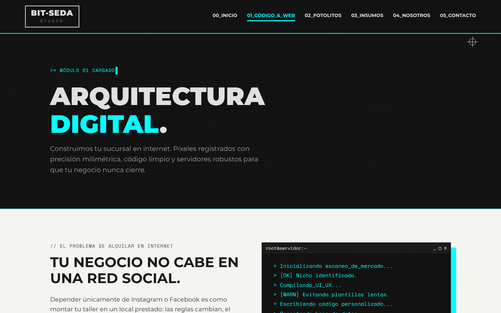
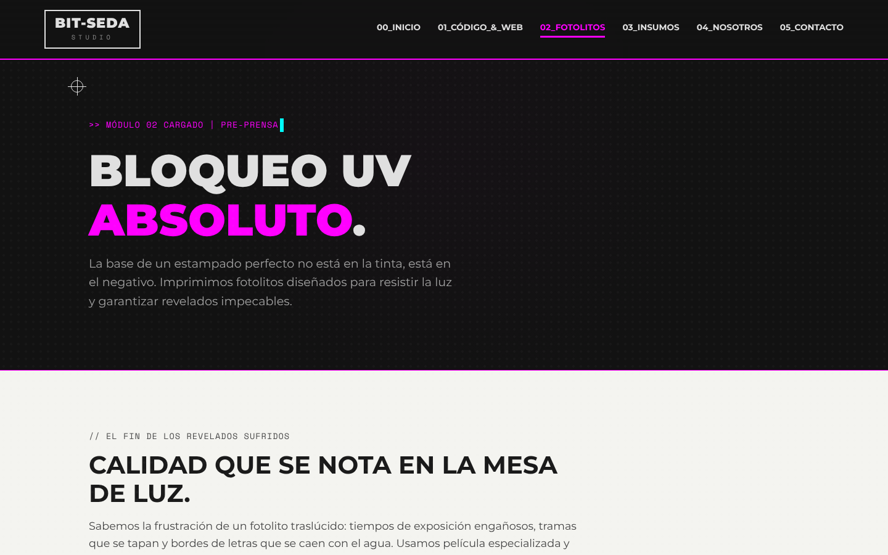
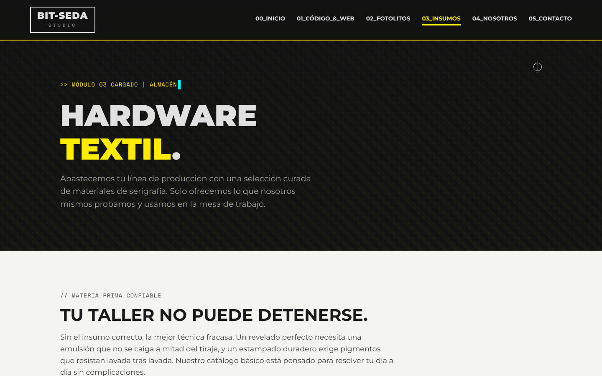
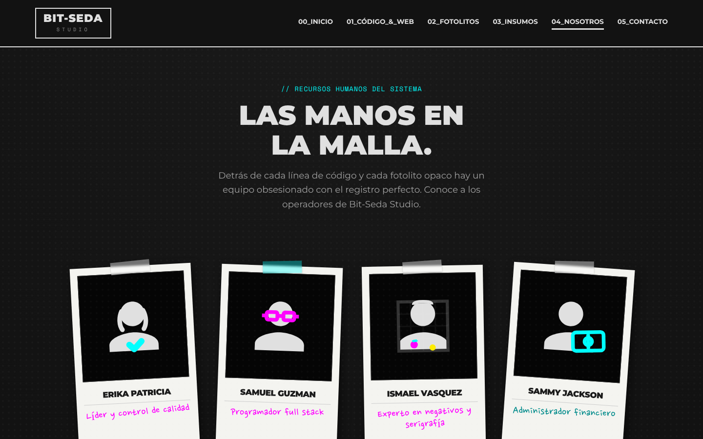
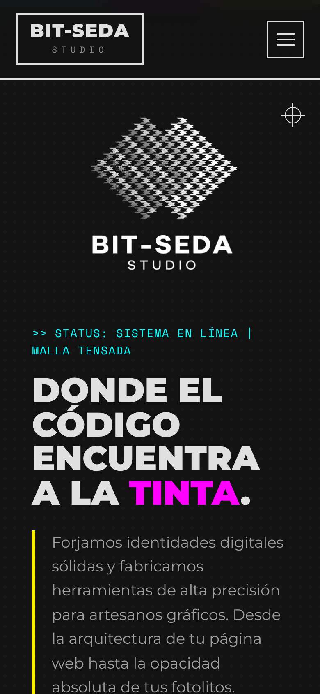

# Bit-Seda Studio

Website for Bit-Seda Studio, a studio in Villa Nueva, Guatemala, that combines **web development for local businesses** and **screen printing** (film positives and supplies). Built with **HTML, CSS and vanilla JavaScript**, no frameworks and no build step. The site's content is in Spanish.

> **Demo:** [Bit-Seda Studio](https://silversays.github.io/bitseda-studio/)


## About the project

Bit-Seda Studio brings programming and screen printing together in one digital experience. The site presents custom web development services for small businesses, plus high-density film positives and screen printing supplies.

## What this project shows

- **Its own visual direction:** a "CMYK on dark mode" look with print metaphors (registration marks, halftone patterns, an off-register effect).
- **CSS-only animations:** code that types itself and renders live, CMYK layer separation with `mix-blend-mode`, a screen printing squeegee with `clip-path`, a timeline with a data pulse.
- **Maintainable CSS architecture:** tokens in CSS variables, one base stylesheet plus one per page, and a per-page color theme with `data-theme` (a single change recolors the header, navigation and accents).
- **Accessibility:** skip-to-content link, mobile menu with `aria-expanded` and `Esc` to close, `aria-current` in the navigation, visible focus, labeled form fields, decorative animations hidden from screen readers, and `prefers-reduced-motion` support.
- **Form with native validation + custom messages**, an anti-spam honeypot, service preselected from the URL (`contacto.html?servicio=web`) and optional submission to an external endpoint.
- **Actually responsive** (tested from 390 px to 1440 px, no horizontal overflow).
- **Performance:** self-hosted `woff2` fonts, optimized logo image (WebP, 97 KB), zero runtime dependencies.
- **SEO and sharing:** per-page `title` and `description`, Open Graph / Twitter Card, SVG favicon and a 404 page.
- **Automated quality checks:** HTML validation with `html-validate` in GitHub Actions and automatic deployment to GitHub Pages.

## Pages

| Page | Content |
|---|---|
| `index.html` | Home, philosophy and services |
| `web.html` | Web development module, code→browser simulation and work process |
| `fotolitos.html` | Pre-press module (film positives), CMYK separation simulation and file specs |
| `insumos.html` | Supplies catalog and squeegee printing simulation |
| `nosotros.html` | Team in polaroid format with SVG avatars |
| `contacto.html` | Form and contact details |

<p>
  
  
</p>
<p>
  
  
</p>
<p>
  
</p>

## Structure

```
.
├── index.html · web.html · fotolitos.html · insumos.html · nosotros.html · contacto.html · 404.html
├── css/
│   ├── fonts.css          # @font-face (self-hosted fonts)
│   ├── base.css           # tokens, reset, header/footer, buttons, utilities
│   └── pages/             # page-specific styles
├── js/main.js             # mobile menu, reveal on scroll, form
├── assets/
│   ├── fonts/             # Montserrat, Space Mono, Nanum Pen Script (OFL)
│   └── img/               # logo, favicon, Open Graph image
├── docs/screenshots/      # screenshots for this README
└── .github/workflows/     # validation + deployment to GitHub Pages
```

## Running locally

Nothing to install. Any static server works:

```bash
python3 -m http.server 8000     # then open http://localhost:8000
# or
npm start                       # uses "serve"
```

Validate the HTML:

```bash
npm install
npm run lint:html
```

## Customization

- **Colors:** the global variables are at the top of `css/base.css`. Each page's accent is set with `data-theme` on the `<body>`.
- **Contact details:** the phone (`+502 0000 0000`) and email (`hola@bitseda.example`) in `contacto.html` are placeholders and should be replaced with the real ones before publishing.
- **Team:** the names and roles in `nosotros.html` are illustrative and can be replaced or removed.
- **Receiving form messages:** set the URL of a [Formspree](https://formspree.io) form (or a similar service) in the `data-endpoint` attribute of `<form id="contact-form">`. Without an endpoint, the form runs in demo mode and doesn't send anything.
- **Open Graph:** `og:image` should point to an absolute URL once the site is published.

## Deploying to GitHub Pages

1. In **Settings → Pages**, select **Source: GitHub Actions**.
2. Every `push` to `main` runs the HTML validation and publishes the site automatically.

## Credits

- Fonts: Montserrat, Space Mono and Nanum Pen Script (SIL OFL 1.1), via [Fontsource](https://fontsource.org).
- Idea, design and development: Samuel Guzmán.

## License

[MIT](LICENSE)
